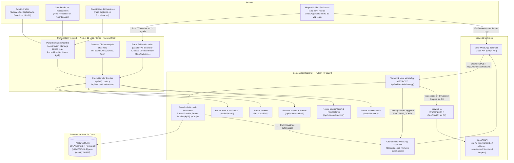
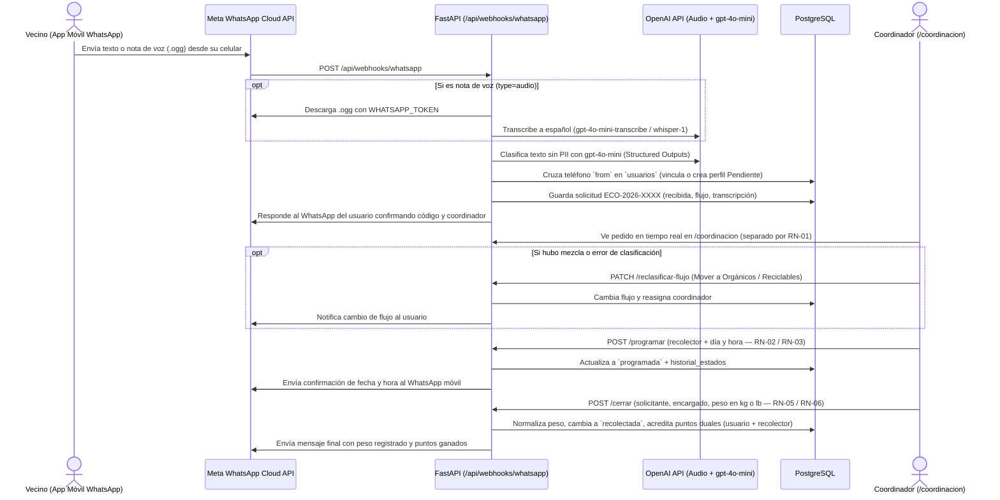

# Arquitectura del Sistema — EcoConecta · Villas de San Pablo

## 1. Diagrama de Componentes y Flujos (Canal Exclusivo WhatsApp Móvil)

---

## 2. Secuencia Completa: WhatsApp Móvil → IA → `/coordinacion` → Puntos Duales

---

## 3. Reglas de Negocio Implementadas

| Regla | Mecanismo de cumplimiento |
| :--- | :--- |
| **RN-01** | Clasificación automática (`organico` / `reciclable`), separación estricta en `get_coordinator_flow()` / `assert_coordinator_flow_access()`, y botón de reclasificación (`Mover a Orgánicos` / `Mover a Reciclables`). |
| **RN-02** | `ProgramarSolicitudRequest` exige `fecha_programada`, `hora_programada` y `nombre_encargado`, enviando confirmación automática al WhatsApp móvil. |
| **RN-03** | Registro obligatorio de `coordinador_id`, `encargado_id` y `nombre_encargado` del colectivo en `solicitudes` y `registros_recoleccion`. |
| **RN-04** | Código único `ECO-YYYY-NNNN`, deduplicación por `whatsapp_message_id` y bitácora inmutable `historial_estados`. |
| **RN-05** | Cierre obligatorio con peso (`kg` o `lb`) que acredita puntos simultáneamente al **usuario/hogar** y al **recolector/huertero encargado** en `movimientos_puntos`. |
| **RN-06** | Reglas parametrizables (`1 kg = 1.0 pt`, `1 lb = 0.5 pts`) y catálogo editable por `administrador` con nota institucional de la Fundación Santo Domingo. |
| **RN-07** | Privacidad e intermediación: consulta pública por código sin PII y redacción de PII innecesario antes de llamar a OpenAI. |
| **RN-08** | Identificación automática por teléfono (`usuarios.telefono_normalizado`), bandera `es_piloto` y marca `pendiente_completar_datos` para nuevos vecinos desde WhatsApp. |
